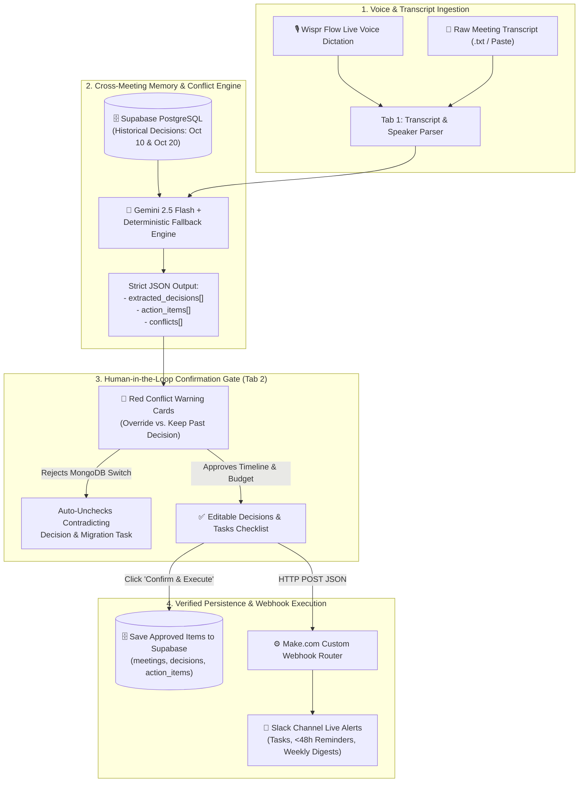

# ⚡ SyncExec AI — Voice-First Meeting-to-Execution Agent

[](https://theproductspace.in/ai-hackathon-details)
[]()
[](https://wisprflow.ai)
[]()

> **Built in 4.5 hours for the Agentic AI Hackathon organized by [Product Space](https://theproductspace.in/) in collaboration with [Wispr Flow](https://wisprflow.ai/).**  
> **SyncExec** eliminates *"meeting amnesia"* by combining persistent **Cross-Meeting Institutional Memory**, an AI **Conflict Detection Engine**, a strict **Human-in-the-Loop Confirmation Gate**, and real-time **Slack/Tracker Webhook Execution**.

---

## 🔗 Quick Links & Live Deliverables

| Resource | Link / Access |
| :--- | :--- |
| 🚀 **Live Deployed Prototype** | **https://sync-and-discover.lovable.app/** |
| 🎥 **3-Minute Demo Video (Loom / Drive)** | **https://www.loom.com/share/5eea6131ec4e4779aaf799d138dd22f9** |
| 💻 **GitHub Repository** | **https://github.com/bhargavaalapati/sync-and-discover** |
| 🎙️ **Wispr Flow Usage Proof** | [Jump to Wispr Flow Voice-First Workflow Section](#-how-we-built-voice-first-with-wispr-flow-20-rubric) |
| 🔔 **Make.com / Slack Webhook** | *Protected on live UI due to free-tier credit limits (Bring-Your-Own-Webhook supported in App Header — see note below)* |

> ### ⚠️ Important Note on Free-Tier Rate Limits & Webhook Credits
> * **LLM & Automation Quotas:** This live prototype operates on **free-tier API quotas** (Gemini API / Supabase Free Tier / Make.com Free Operations). Please trigger live execution buttons mindfully during testing!
> * **Webhook URL Protection:** To prevent exhausting our Make.com free-tier operation credits before judge evaluation, the default production Make.com Webhook URL is masked (`[PROTECTED_FREE_TIER_WEBHOOK]`). Judges can see the live Slack execution in our **Demo Video & Screenshots below**, or paste any test webhook URL (e.g., `webhook.site`, Slack Incoming Webhook, or Make.com URL) directly into the **Header Webhook Input Bar** for instant live verification.
> * **Resilient Fallback Engine:** Even if free-tier LLM rate limits are reached during peak judging traffic, SyncExec includes a built-in **Deterministic Conflict & Extraction Fallback Parser** so the demo experience never breaks.
> * **Continuous Updates:** We are actively shipping daily UI refinements, rate-limit optimizations, and direct tracker integrations.

---

## 🎯 The Problem: "Meeting Amnesia" (Problem Statement 03)

Standard AI meeting note-takers (Otter, Fireflies, basic LLM wrappers) suffer from two fatal flaws in real engineering and product teams:
1. **Zero Cross-Meeting Memory:** Every call is summarized in a vacuum. If a team locks **PostgreSQL** as their primary database on **October 10** and caps the marketing budget at **$5,000** on **October 20**, and an engineer casually says *"Let's switch to MongoDB and spend $8,000"* on **October 31**, standard AI summarizers blindly turn those contradictions into tasks without flagging that they violate governing decisions.
2. **Unverified Tracker Pollution:** Blindly pushing AI-extracted tasks into Jira, Trello, Linear, or Slack without human verification floods engineering backlogs with hallucinated or rejected scope.

---

## 💡 Our Solution: SyncExec AI

**SyncExec** is an end-to-end **Meeting-to-Execution Agent** designed around a 4-stage institutional memory loop:

### 1. 🎙️ Voice & Transcript Ingestion (`Tab 1: Ingest Meeting`)
* Supports raw speaker-labeled transcripts (`Speaker (Role): Statement`), `.txt/.vtt` file uploads, and **live hands-free voice dictation powered by Wispr Flow**.
* Automatically parses speakers, line counts, and meeting metadata (`Title`, `Date`).
* Includes a **1-Click "Load Oct 31 Live Demo Transcript"** button for instant judge evaluation.

### 2. 🛡️ Human-in-the-Loop Conflict & Confirmation Gate (`Tab 2: Review & Confirm Gate`)
* **Historical Cross-Reference:** Before extracting tasks, SyncExec fetches all governing decisions from the Supabase `decisions` table and compares the new transcript against historical context.
* **High-Contrast Red Conflict Banners:** Flags exact contradictions, citing:
  * **The New Statement & Speaker** (e.g., *Rahul: "Switch primary database to MongoDB by Nov 5"*)
  * **The Contradicted Past Decision & Date** (e.g., *"[2026-10-10] Exclusively use PostgreSQL as primary production database"*)
  * **Severity & Conflict Explanation**
* **1-Click Resolution Controls (`Override` vs. `Keep Past Decision`):**
  * Clicking **"Keep Past Decision (Reject Change)"** automatically unchecks both the contradicting new decision **and** any downstream action item (e.g., rejecting the MongoDB switch automatically unchecks the *"Complete MongoDB cluster migration"* task so bad scope never reaches the tracker!).
* **Inline Editing & Checkboxes:** Every extracted decision and action item can be edited inline or unchecked before clicking **Confirm & Execute**.

### 3. 🧠 Persistent Decision Memory Vault (`Tab 3: Decision Memory Vault`)
* Searchable, speaker-filterable institutional ledger of all verified decisions across historical meetings (`Oct 10`, `Oct 20`, `Oct 31`).
* Eliminates context loss when onboarding new engineers or auditing why a timeline or architecture shifted.

### 4. ⏰ <48-Hour Urgency Radar & Per-Person Weekly Digests (`Tab 4: Digests & Reminders`)
* **Per-Person Filtering:** Filter execution state by team member (`Priya (PM)`, `Rahul (Eng)`, or `All Team`).
* **48-Hour Deadline Radar:** Automatically compares task deadlines against the current date (`2026-10-31`) and highlights tasks due on `Nov 1` or `Nov 2` with a pulsing **`URGENT: DUE IN < 48H`** badge.
* **1-Click Slack Deadline Reminders:** Fires an immediate targeted alert via Make.com Webhook to Slack.
* **Executive Weekly Digest Generator:** Synthesizes a person's Critical 48h Priorities, Open Backlog, Completed Wins, and Authored Decisions into a structured briefing and posts it directly to Slack.

---

## 🎙️ How We Built Voice-First with Wispr Flow (20% Rubric)

**[Wispr Flow](https://wisprflow.ai/)** was central to both our **development velocity** (building the product in under 4.5 hours despite power cuts and 5G tethering) and our **live product UX**:

1. **Voice-Driven System Architecture & Prompt Engineering (150+ WPM):**
   Instead of manually typing complex multi-tab specifications, SQL migrations, and JSON schemas, we dictated our system prompts, edge-function specifications, and TypeScript fallback parsers directly into our AI IDE and builders using Wispr Flow.
2. **Dictating Realistic Multi-Meeting Test Scripts:**
   We used Wispr Flow to rapidly voice-act and transcribe the multi-turn dialogues between `Priya (PM)` and `Rahul (Eng)` across Meetings 1, 2, and 3.
3. **Live In-App Voice Ingestion:**
   During live meetings or emergency standups, users click into SyncExec's transcript box, hold their **Wispr Flow hotkey**, and dictate live action items hands-free (e.g., *"Rahul: I will run load testing on the webhook ingestion endpoint by November 1, 2026"*).

### 📸 Wispr Flow Usage & Product Screenshots

| Wispr Flow Dictation History & Stats | Wispr Flow Active Voice Pill in SyncExec |
| :---: | :---: |
| [Wispr Flow History](https://drive.google.com/file/d/1v39fMeGcHplwST5oXKyiqYgDbMUjyHRK/view?usp=sharing) | [Wispr Flow Live Dictation](https://drive.google.com/file/d/1iRy0Fx6WwKPAjq_-lxpZCm5lvmpeVzra/view?usp=sharing) |

| Red Conflict Detection & Confirmation Gate | Live Make.com → Slack Webhook Execution |
| :---: | :---: |
| [Conflict Gate UI](https://drive.google.com/file/d/1XxWBRLiyPqcy12AIEEkVyEhasSkjMn6j/view?usp=sharing) | [Slack Webhook Alerts](https://drive.google.com/drive/folders/1UbvcrF9Bdr-ytOqCjhWtaIeRBJBo-kEU?usp=sharing) |

---

## 🏗️ System Architecture & Data Flow


----

## 🗄️ Database Schema (Supabase PostgreSQL)

Run the following SQL in the **Supabase SQL Editor** to initialize the schema and seed the historical cross-meeting memory (`Oct 10` & `Oct 20`):

```sql
-- 1. Create Tables
CREATE TABLE IF NOT EXISTS meetings (
  id UUID PRIMARY KEY DEFAULT gen_random_uuid(),
  title TEXT NOT NULL,
  date TEXT NOT NULL,
  raw_transcript TEXT NOT NULL,
  created_at TIMESTAMPTZ DEFAULT NOW()
);

CREATE TABLE IF NOT EXISTS decisions (
  id UUID PRIMARY KEY DEFAULT gen_random_uuid(),
  meeting_id UUID REFERENCES meetings(id) ON DELETE CASCADE,
  speaker TEXT NOT NULL,
  decision_text TEXT NOT NULL,
  created_at TIMESTAMPTZ DEFAULT NOW()
);

CREATE TABLE IF NOT EXISTS action_items (
  id UUID PRIMARY KEY DEFAULT gen_random_uuid(),
  meeting_id UUID REFERENCES meetings(id) ON DELETE CASCADE,
  task TEXT NOT NULL,
  owner TEXT NOT NULL,
  deadline TEXT NOT NULL,
  status TEXT DEFAULT 'open',
  synced_to_tracker BOOLEAN DEFAULT FALSE,
  created_at TIMESTAMPTZ DEFAULT NOW()
);

-- 2. Seed Meetings 1 & 2 (Persistent Cross-Meeting Memory)
INSERT INTO meetings (id, title, date, raw_transcript) VALUES
('11111111-1111-1111-1111-111111111111', 'Q4 Architecture & Beta Timeline Sync', '2026-10-10', 'Priya (PM): We are launching the beta on November 15, 2026. Rahul (Eng): Agreed, we will exclusively use PostgreSQL.'),
('22222222-2222-2222-2222-222222222222', 'Sprint 4 API & GTM Budget Review', '2026-10-20', 'Priya (PM): Q4 marketing budget is capped at $5,000. Rahul (Eng): I will finish the JWT auth API by November 2, 2026.');

INSERT INTO decisions (meeting_id, speaker, decision_text, created_at) VALUES
('11111111-1111-1111-1111-111111111111', 'Priya (PM)', '[2026-10-10] Public beta launch date is locked for November 15, 2026.', '2026-10-10T10:00:00Z'),
('11111111-1111-1111-1111-111111111111', 'Rahul (Eng)', '[2026-10-10] Exclusively use PostgreSQL as primary production database; no NoSQL.', '2026-10-10T10:05:00Z'),
('22222222-2222-2222-2222-222222222222', 'Priya (PM)', '[2026-10-20] Total Q4 beta marketing budget is strictly capped at $5,000.', '2026-10-20T14:00:00Z'),
('22222222-2222-2222-2222-222222222222', 'Rahul (Eng)', '[2026-10-20] Use JWT-based OAuth2 with Google and GitHub for authentication.', '2026-10-20T14:10:00Z');
```

---

## 🔌 Webhook Payload Contract (Make.com → Slack)

Whenever a user clicks **Confirm & Execute**, **Send Deadline Reminder**, or **Post Weekly Digest**, SyncExec sends a structured `POST` request to the configured Webhook URL:

```json
{
  "event_type": "confirm_and_execute",
  "meeting_title": "Emergency Pre-Launch Sync",
  "meeting_date": "2026-10-31",
  "approved_decisions": [
    {
      "speaker": "Priya (PM)",
      "decision_text": "Push public beta launch date to November 25, 2026"
    },
    {
      "speaker": "Priya (PM)",
      "decision_text": "Increase Q4 beta marketing budget to $8,000"
    }
  ],
  "approved_tasks": [
    {
      "task": "Patch the staging CORS headers",
      "owner": "Rahul (Eng)",
      "deadline": "2026-11-01",
      "status": "open"
    },
    {
      "task": "Update investor launch deck with Nov 25 timeline and $8,000 budget",
      "owner": "Priya (PM)",
      "deadline": "2026-11-02",
      "status": "open"
    }
  ],
  "target_person": "All Team",
  "digest_summary": "Synced 2 verified decisions and 2 approved tasks from Review Gate (1 conflict rejected)."
}
```

---

## 🧪 60-Second Judge Testing Guide

1. **Step 1 — Verify Historical Memory:**
   Open the **[Live App](https://sync-and-discover.lovable.app/)** and click **"1-Click Seed Oct 10 & Oct 20 Memory"** in the header (or view **Tab 3: Decision Memory Vault**) to see the 4 governing decisions (`Nov 15 launch`, `PostgreSQL locked`, `$5,000 budget cap`, `JWT OAuth2`).
2. **Step 2 — Ingest the Oct 31 Emergency Transcript:**
   Go to **Tab 1: Ingest Meeting**, click **"Load Oct 31 Live Demo Transcript"** (or dictate a new line using **Wispr Flow**), and click **"Analyze Transcript & Detect Conflicts"**.
3. **Step 3 — Resolve the 3 Red Conflicts in the Human-in-the-Loop Gate:**
   In **Tab 2: Review & Confirm Gate**, inspect the **3 Red Conflict Cards**:
   * **Conflict 1 (Launch Date):** `Nov 25, 2026` contradicts `Nov 15, 2026` (`Oct 10`) → Click **Override Past Decision**.
   * **Conflict 2 (Database Switch):** `MongoDB` contradicts `PostgreSQL` (`Oct 10`) → Click **Keep Past Decision (Reject Change)** and watch it automatically uncheck Rahul's MongoDB migration task!
   * **Conflict 3 (Marketing Budget):** `$8,000` contradicts `$5,000` (`Oct 20`) → Click **Override Past Decision**.
4. **Step 4 — Execute & Inspect 48-Hour Urgency Radar:**
   Click **"Confirm & Execute Approved Items"**, then navigate to **Tab 4: Weekly Digests & Reminders**. Select **Rahul (Eng)** to see his tasks due within 48 hours (`Nov 1` & `Nov 2`) flagged in red, and click **"Generate Weekly Digest"**.

---

## 💻 Local Setup & Installation

```bash
# 1. Clone the repository
git clone https://github.com/bhargavaalapati/sync-and-discover
cd syncexec-ai

# 2. Install dependencies
npm install

# 3. Start the development server
npm run dev
```

*(Optional)* You can configure your own `Supabase URL`, `Supabase Anon Key`, `Gemini API Key`, and `Make.com Webhook URL` at runtime directly via the **Settings** modal in the top-right corner of the app header.

---

## 👥 Team & Hackathon Journey

Built during the **Product Space x Wispr Flow Agentic AI Hackathon (Oct 31, 2026)**—shipped through late-night Bengaluru rain, power cuts, 5G mobile hotspot tethering, and a buzzer-beater 11:59 PM IST submission!

* **Alapati Bhargava Rama Bharadwaja** — Full-Stack Architecture, Supabase Memory Engine, Make.com/Slack Webhook Integration & Voice-First QA
* **Devadula Venkata jayanth** — Product Strategy, UI/UX Flows & Repository Engineering

---

*Built with ❤️, voice-first speed via **[Wispr Flow](https://wisprflow.ai/)**, and community energy from **[Product Space](https://theproductspace.in/)**.*
